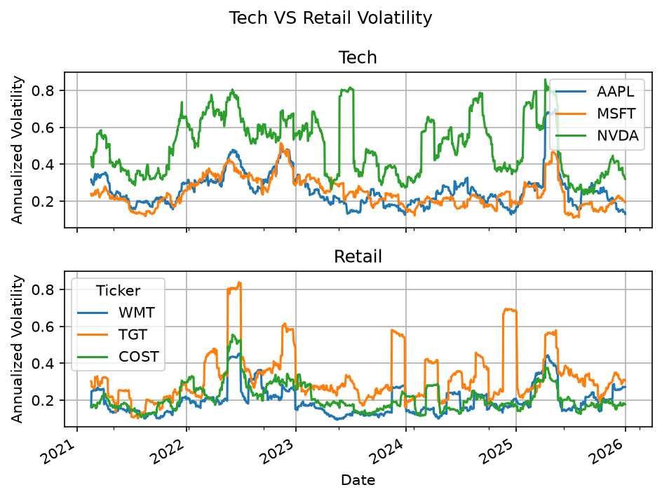
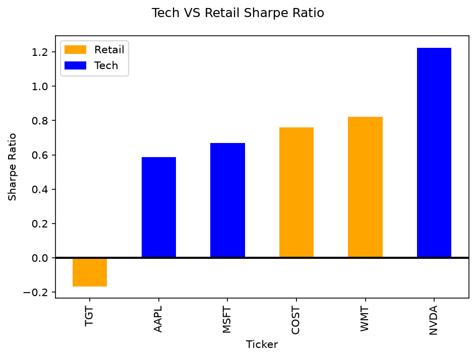

# Sector Volatility & Sharpe Ratio Analysis

Compares the volatility and risk-adjusted returns (Sharpe ratios) of technology and retail stocks from 2021 to 2025, using daily price data from Yahoo Finance.

| Sector | Tickers |
|---|---|
| Technology | AAPL, MSFT, NVDA |
| Retail | WMT, TGT, COST |

## Method

1. Download daily split- and dividend-adjusted closing prices for 2021-01-01 to 2025-12-31 with `yfinance`.
2. Compute daily percentage returns.
3. Compute 30-day rolling volatility, annualized by √252.
4. Compute a full-period Sharpe ratio per stock: annualized mean return minus a fixed 3% risk-free rate, divided by annualized volatility.

## Results

| Ticker | Sector | Annual return | Annual volatility | Sharpe ratio |
|---|---|---|---|---|
| NVDA | Tech | 66.9% | 52.2% | 1.22 |
| WMT | Retail | 20.1% | 20.9% | 0.82 |
| COST | Retail | 20.1% | 22.5% | 0.76 |
| MSFT | Tech | 20.2% | 25.7% | 0.67 |
| AAPL | Tech | 19.3% | 27.9% | 0.59 |
| TGT | Retail | -2.9% | 35.2% | -0.17 |

### Rolling volatility



### Sharpe ratio



## Conclusion

The stock with the best Sharpe ratio was NVIDIA. Overall, retail sector had lower volatility led by Walmart (21%) and Costco (23%) volatility. Target was the only outlier having a 35% volatility. During the beginning of 2025, all 6 stocks' volatility spiked upwards showing a market wide trend meaning that owning either sector did not protect investors from high volatility in the beginning of 2025. The tech sector had an overall higher Sharpe ratio than retail. However, this conclusion is limited since only 3 stocks represented each sector. The average Sharpe ratio of the tech sector was largely driven by NVIDIA indicating the requirement of larger sample sizes to more accurately determine the sector performance of tech and retail industry.

## How to run

```bash
pip install -r requirements.txt
```

Open `notebooks/volatility_analysis.ipynb` in Jupyter or VS Code and run the cells top to bottom. The charts are saved to `outputs/`.
